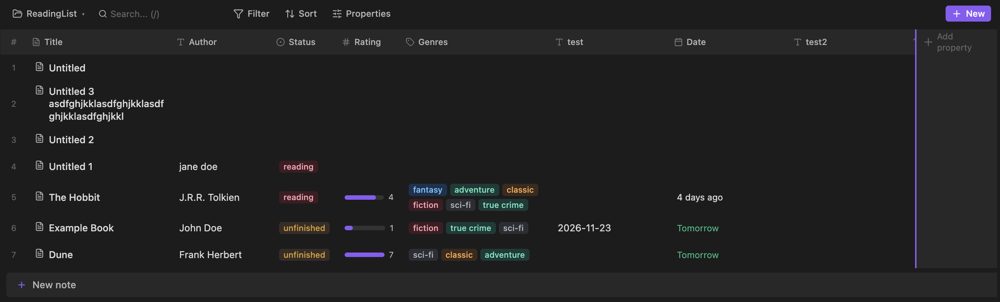

# Obsidian DB UI Plugin

[(this) GitHub Repository](https://github.com/andrei-akopian/ObsidianDBUI) | [MIT License](./License.md)

This is a plugin for giving obsidian "bases" (databases) a good UI, similar to notion. Author believes this plugin has a more refined UI than similar plugins such as DataLoop, or GoodBases, or Notion Bases plugins.

> [!WARNING]
>
> Code is LLM written. The author has used it for less than **1** days. His use case is managing his ~1000 book reading list. Functionality outside this range might be poor.



## Roadmap

- [ ] Create a system for type cross conversation.
- [ ] More sophisticated source selection via regex or wildcard matching.
- [ ] better "Untitled" filename editing, and templates for new notes.

---
---

## LLM Generated Docs 

## 🛠️ Building From Source

### Prerequisites
- [Node.js](https://nodejs.org/) (version 18 or higher recommended; Node 20+ tested)
- npm (bundled with Node.js)

### Build Steps

1. **Clone the repository:**
   ```bash
   git clone https://github.com/Andrei08/ObsidianDBUI.git
   cd ObsidianDBUI
   ```

2. **Install dependencies:**
   ```bash
   npm install
   ```

3. **Run unit tests:**
   ```bash
   npm test
   ```

4. **Build the production bundle:**
   ```bash
   npm run build
   ```

   This executes TypeScript type checking (`tsc --noEmit`) and bundles the plugin using `esbuild`. The compiled bundle is output to `main.js`.

---

## 📥 Importing into Other Obsidian Vaults

To install DB UI into any Obsidian vault:

### Step 1: Locate Your Vault's Plugin Directory
Each Obsidian vault stores its community plugins in a hidden `.obsidian/plugins/` directory:
- **macOS:** `/Users/<username>/path/to/YourVault/.obsidian/plugins/`
- **Windows:** `C:\Users\<username>\path\to\YourVault\.obsidian\plugins\`
- **Linux:** `/home/<username>/path/to/YourVault/.obsidian/plugins/`

> **Note:** If hidden folders are hidden in your OS file manager:
> - On macOS, press `Cmd + Shift + .` in Finder to toggle hidden files.
> - On Windows, enable "Hidden items" under the View tab in File Explorer.

### Step 2: Create the Plugin Folder
Inside `.obsidian/plugins/`, create a new folder named `obsidian-db-ui`:
```bash
mkdir -p "/path/to/YourVault/.obsidian/plugins/obsidian-db-ui"
```

### Step 3: Copy the Distribution Files
Copy the following three files from the build into the new `obsidian-db-ui` folder:
1. `main.js` (generated by `npm run build`)
2. `manifest.json`
3. `styles.css`

Example command on macOS / Linux:
```bash
cp main.js manifest.json styles.css "/path/to/YourVault/.obsidian/plugins/obsidian-db-ui/"
```

### Step 4: Enable the Plugin in Obsidian
1. Open Obsidian and open your target vault.
2. Go to **Settings** (`Cmd + ,` or `Ctrl + ,`) -> **Community plugins**.
3. If "Restricted mode" is on, turn it off to enable community plugins.
4. Under "Installed plugins", click the **Check for updates / Reload plugins** button.
5. Find **DB UI** in the list and toggle the switch to **On**.

---

## 🚀 Usage

### 1. Dedicated `.dbui` File
- Click the **DB UI** table icon in the left ribbon bar, or run the command `DB UI: Create new database table` from the Command Palette (`Cmd/Ctrl + P`).
- Right-click any folder in your file explorer and choose **"New Database Table in this folder"**.
- A `.dbui` file will be created and opened in Obsidian. Select your target source folder from the top toolbar dropdown.

### 2. Embedded Tables in Notes
Embed a database table directly into any Markdown note using the ````dbui```` code block:

**Reference an existing `.dbui` file:**
````markdown
```dbui
file: "Databases/ReadingList.dbui"
```
````

**Inline configuration:**
````markdown
```dbui
folder: "Books"
includeSubfolders: true
```
````
